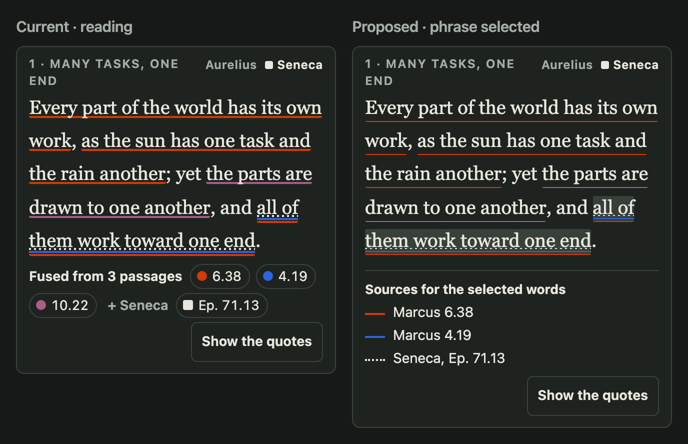

# Review handover for Astra — Stoic Constitution, milestone M1

Written 23 November 2026. You are asked for a second, independent review of work another model did today. A first review exists (section 4). Its findings are claims for you to confirm or dispute, not conclusions to repeat. Please form your own view of the code and of Article 6 before reading section 4.

The completed [second review and milestone decision](#7-second-review-and-milestone-decision) follow the original brief.

Claude’s revision brief is in [section 8](#8-feedback-for-claude). It includes reproducible code findings, a visual comparison of the underlines, and the owner’s request for a project translation of *Meditations*.

## 1. What you are reviewing

The product is one static page, `public/apps/stoic-constitution.html`. It builds a "constitution" from Marcus Aurelius's *Meditations*: each topic section becomes an article, every word of an article is traced to exact quoted passages, and Seneca can be switched on to see what each article gains.

Milestone M1 of [the delegation plan](32-delegation-plan.md) was carried out by Claude Opus 5.5 in one run. It delivered:

| Part | What | Where |
|---|---|---|
| Tools | A script that prints a section for quoting | `scripts/aurelius-section.py` |
| Tools | A headless browser check that exits 1 on failure | `scripts/aurelius-constitution-check.py` |
| Data | The build writes a small index plus one file per chapter | `scripts/aurelius-constitution.py` (search `CHAPTER_DIR`) → `public/apps/stoic-constitution.json`, `public/apps/stoic-constitution/c6.json` |
| Page | Chapters load on demand; a chapter picker in the sticky bar | `public/apps/stoic-constitution.html`: `readVoices`, `readChapter`, `readSelection`, `loadChapter`, `renderBar`, `toggleChapters`, `openChapter`, `goToArticle`, the document-level click handler after it; CSS `.chap-btn`, `.chapters`, `.loading` |
| Tests | A `load()` helper, a test of the split, five tests relaxed from "exactly five articles" | `tests/aurelius/constitution.test.mjs` |
| Content | Article 6, "What the whole sends in its season" (section `c6.s6`), with Seneca | `content/aurelius/constitution.json`, the entry with `"number": 6` |

**There is no clean diff for M1.** Nothing has been committed since `d576e71`; M1 sits in the working tree on top of earlier uncommitted work (colour per passage, the vectors column, Seneca, cards). Use the table above to find the M1 parts. The run's own account is the last entry of `docs/aurelius/implementation-log.md`.

Read before judging content: `apps/aurelius/prompts/constitution-article.md` (15 rules, each from the owner's feedback) and section W3 and W4 of the plan (the procedure the run was told to follow).

## 2. How to run things

From the repo root. The private corpus under `.aurelius/` is needed for the build and the section reader; it is on the owner's machine and not in git.

```bash
PY=apps/aurelius/.venv/bin/python
$PY scripts/aurelius-constitution.py                      # validate the record, write the index and chapter files
node --test tests/aurelius/constitution.test.mjs tests/aurelius/composition-study.test.mjs   # 20 pass
npx next dev -p 3170                                      # then http://localhost:3170/apps/stoic-constitution.html?with=seneca#article-6
$PY scripts/aurelius-constitution-check.py                # needs the dev server; exits 0 today
$PY scripts/aurelius-section.py c6.s6 --seneca            # the six passages in full, then the 50 Seneca candidates
```

Seneca's full text for a word search: `.aurelius/corpora/seneca-gummere-wikisource/corpus.json` (`passages[].reference`, `.text`).

**Limits for your review.** Read-only unless the owner says otherwise: no commit, no push (a push to `main` deploys the public site), no paid call (`scripts/aurelius-seneca.py embed` is the only one), nothing under `.aurelius/` copied into a tracked file.

## 3. What the run claimed

Build clean; 20 of 20 tests; browser check exit 0 with and without Seneca; production build passes; Articles 1 to 5 unchanged pixel for pixel at 390 and 1440 px apart from the top bar; nothing committed; embedding cost about $0.00003. The first review re-ran the tests and the browser check and confirms those numbers. It did not re-run the pixel comparison.

## 4. First review: findings to confirm or dispute

Reviewer: Claude Fable 5.2, who wrote the plan and Articles 1 to 5, so not a neutral party. Where a finding is against that earlier work, it says so.

### A. Article 6 content

| # | Finding | Evidence | Weight |
|---|---|---|---|
| A1 | **A Seneca quote is used against its meaning.** `S71.13c` ("Nature sends forth all these things towards the same goal") backs "all of them work toward one end". In Letter 71.13 the "same goal" is ceasing to exist: the sentences before and after are about everything growing old and perishing. | Read Ep. 71.13 in the corpus. | High |
| A2 | **A second Seneca quote is weak in the same way.** `S71.13a` ("All things move in accord with their appointed times") backs "it comes at the right time"; the appointed times there are birth, growth and destruction. | Same passage. | Medium |
| A3 | **The best-known Seneca parallels were never looked at.** W4 step 4 says to search the corpus by words as well as reading the vector candidates. The run read the 50 candidates only. A word search finds Ep. 107.11 ("the willing soul Fate leads, but the unwilling drags along") and Ep. 74.20 ("Let man be pleased with whatever has pleased God"), neither among the candidates. Both say what claim 3 says, more directly than what was used. | `grep` the candidates output for `107.11` and `74.20`: absent. | High |
| A4 | **Claim 3 is three single-source parts set side by side**, which is the "concatenation" the owner rejected (rule 1, rule 8). "I want what the world wants" rests on 10.22 only, "whatever its seasons bring…" on 4.19 only, "I pray for everyone" on 5.7 only. Across the article 3 of 11 claim components rest on two passages (27%); the plan's bar is a third. | Component split by backing passages, same rule as the page. | High |
| A5 | **The overlap with Article 3 is not declared.** Article 3 already says what happens "serves the whole… and what serves the whole is not bad for the part" and "be glad of it". Article 6's claim 2 and statement say nearly the same. The plan requires naming the overlap in `limit`; Article 6's `limit` does not mention Article 3. The nearest-sections panel puts Article 3 first, at 0.78. | Compare the two statements and Article 3's claims 2 and 4. | Medium |
| A6 | **Loose backing inside claim 1.** 4.19 "to thee all tend" is mapped to "all of them work toward one end": tending back to nature is not the same as co-operating toward an end. And 5.7 (rain on the Athenians' fields) backs "I pray for everyone". | The `gives` of `4.19d` and `5.7a`. | Low |
| A7 | **An item filed as "Adds" is partly a challenge.** `w3` (hold my ground and push back) sits under When it breaks as an addition, while its own `why` says it is "nearer the onset that Marcus forbids" in 8.54. The schema cannot attach a challenge to a said-once item, only to a fused claim. | `voices.seneca.items`, key `w3`. | Low; a schema question |
| A8 | **Two Seneca quotes repeat earlier articles**: `S96.2b` (also Article 3) and `S71.13a` (also Article 5). Allowed by the plan; nothing warns about it. | The run flagged this itself. | Low |

Worth your own reading, not yet judged: whether the statement ("What the whole sends me is good for me and comes at the right time, so I want what the world wants.") sounds like an article of a constitution; whether each `follows` sentence really follows from its passage alone; whether the two body clauses read as part of their sentences.

### B. Page and data

| # | Finding | Evidence | Weight |
|---|---|---|---|
| B1 | **Switching chapters was never exercised with two chapters**, because only chapter 1 has articles. The first review simulated a second one (Playwright `route`: serve an index in which Articles 4 to 6 belong to `c3`, and two chapter files). Switching by the picker, a neighbours link into the other chapter, `?at=5.c1` and `#article-6` all worked, with Seneca kept and the open panel cleared. The browser check should gain this simulation; today it cannot see a regression here. | Method above; no errors at 390 or 1440. | Medium (gap in the gate) |
| B2 | **The back button leaves the page after a chapter switch.** Chapter changes use `history.replaceState`. On a phone: tap a neighbour in another chapter, press back, and you are out of the constitution. | Simulated run: `go_back()` lands on the previous site. | Medium |
| B3 | **After a switch the chapter heading sits under the sticky bar.** `openChapter(..., {to: 'top'})` scrolls `#articles` to y = 0; the bar covers 0 to 56 px; the step line is hidden and the heading is clipped. `#articles` has no `scroll-margin-top`. | Simulated run: bar bottom 56, heading top 52, step line top 29. | Low; one line of CSS |
| B4 | **A typed or restored `#article-N` in another chapter does nothing**: there is no `hashchange` listener, only the click handler. | Simulated run. | Low |
| B5 | **`?without=` for an article outside the open chapter is dropped from the link** on load, so a shared link loses removed passages of other chapters. | `?c=c3&without=1:9.7` → `?c=c3`. | Low |
| B6 | **Phone bar.** At 390 px the bar shows Chapter, 1 to 4; 5, 6, Topics and the Sources switch need a sideways scroll. Chapter 2 has twelve articles. | The run flagged this itself. | Medium before chapter 2 |
| B7 | **A drawing error is reported as a loading error.** `openChapter` draws inside the same promise chain as the fetch, so an exception in `articleCard` shows "This chapter could not be loaded" with a retry button. | Read `openChapter`. | Low |
| B8 | **Chapter files are pretty-printed.** `c6.json` is 278 KB, 220 KB minified, for 6 articles and 60 passages. Chapter 2 has 12 articles and 136 passages, so it will pass the plan's own 600 KB warning line unless the files are written compactly. Seneca's part is about half of an article's bytes. | `json.dumps(..., separators=(',', ':'))` on the file. | Medium before chapter 2 |
| B9 | **The topic tree always opens chapter 1**, whichever chapter is on screen. | Simulated run. | Low |

### C. Gates that let things through (earlier work, not M1)

| # | Finding | Weight |
|---|---|---|
| C1 | The test for multi-source components checks 35% over all articles together. Per article it is 32, 67, 53, 31, **0** and 27%. Article 5 (written by the first reviewer) has no component resting on two passages, and passes. The build should print the share per article and the test should bound it per article, with an allowance for small sections. | High for what comes next: 32 more articles will be written against this gate |
| C2 | The colour assignment only separates passages that meet in one claim or one statement part. In Article 6's statement, 10.21 and 10.22 share pink, so all three parts look as if the same two passages back them. Passages that appear anywhere in the same sentence should differ when five colours allow it. | Medium |
| C3 | Nothing checks that an added author's quote says what the claim says in its own context. A1 passed every automated check. Only reading catches it; the plan's risk table says so but the procedure has no explicit "read the sentences around the quote" step. | Medium |
| C4 | Section 1 of the plan still describes the state before M1; the run added a progress line above it instead of updating the table. | Low |

### D. What was done well

Every quote is an exact span on the first build, copied from the section reader. The regression check was real: a pixel comparison, then a controlled re-shoot to explain the one difference at 390 px. Loading, failure and retry were each tested. The report named its own soft spots (repeated quotes, shared colours, the phone bar). Nothing was committed or pushed, and the one paid call was previewed and capped.

## 5. What the first review did not check

- Article 6 on a real phone, and in dark mode by eye (the browser check measures; nobody looked).
- A screen reader pass on the chapter picker (it has `aria-expanded`, `aria-controls`, `aria-current`; focus moves into the list on open and back on Escape, untested with assistive technology).
- Offline: the site has a service worker and a "Save on this phone" catalog (`public/sw.js`, `scripts/write-offline-catalog.mjs`). The chapter file is in the catalog. Whether an old saved index can meet a newer chapter file was not tested.
- The `follows` sentences of Article 6 one by one against their passages.
- The relaxed tests line by line against the table in W1.3 of the plan.
- The three failing tests outside this work (`tests/aurelius/book.test.mjs`, `tests/aurelius/real-corpus.test.mjs`, `tests/fitness/machine-specs.test.mjs`); they predate M1.

## 6. What the owner needs from you

1. For each finding in section 4: **confirmed**, **disputed** (say why) or **cannot tell**.
2. Anything the first review missed, with the file, the evidence and how to reproduce it.
3. Your own verdict on Article 6: keep, revise or redo, and the two or three changes that matter most.
4. One judgment call: should the next run fix A1 to A5 and C1 before any of Articles 7 to 38 is written, or can chapter 2 start in parallel? The first review's view is that C1 and the W4 word-search step (A3) must be fixed first, because every later article passes through them.

Keep the answer short: a table for item 1, a list for item 2, a paragraph each for 3 and 4.

## 7. Second review and milestone decision

23 November 2026 · **Revise Article 6 before using it as a model for chapter 2.** The strongest section pairs 10.21 with 4.19 on timeliness. The weakest treats sharing a destination as evidence of working together. A separate reader checked all 29 quoted pieces against their contexts without seeing the first review.

### Findings on the first review

Claim numbers below follow the **display**. In the [authored record](../../content/aurelius/constitution.json), Claim 1 is `c3` (cooperation), Claim 2 is `c1` (timeliness), and Claim 3 is `c2` (wanting what the world wants).

| Item | Verdict | Evidence and consequence |
|---|---|---|
| A1 | Confirmed | Ep. 71.13 gives perishing and dissolution as the destination. Remove `S71.13c` from the backing for cooperation. Ep. 74.20 is a stronger candidate for that specific claim. |
| A2 | Confirmed | Birth, growth and destruction have appointed times in Ep. 71.13. That gives no reason why the time is right *for the recipient*. Narrow the mapping or remove it. |
| A3 | Cannot tell whether the author searched | Neither 107.11 nor 74.20 is among the 50 returned candidates. That establishes a retrieval miss. For willing assent compare 107.10–11, where Seneca renders Cleanthes. For preservation of the whole compare 74.20. Record the words searched and why a candidate was accepted or rejected. |
| A4 | Confirmed | Claim 3's assent, harvest and prayer draw separately on 10.22, 4.19 and 5.7. The article total is 3/11 shared components. Treating the prayer as a separate practice would give the joint claim a clearer boundary. |
| A5 | Confirmed | The limit omits Article 3. The nearest-section results are 0.775 for Article 3 and 0.774 for Article 5. The textual overlap on welcoming what serves the whole is better evidence than this narrow numerical lead. Article 6's distinctive contribution is timing. |
| A6 | Confirmed | 4.19 supports tending back to nature. Cooperation across different tasks comes from 6.38. The rain prayer names the Athenians’ fields; “everyone” expands its scope. |
| A7 | Disputed as a challenge | Marcus rejects a violent onset against an obstacle. Seneca describes standing up to suffering. Disciplined resistance can satisfy both. Keep this as an addition and clarify its object before changing the schema. |
| A8 | Confirmed | The authored IDs recur in Articles 3/6 and 5/6 respectively. Reuse is permitted. The consequential error is what `S71.13a` is asked to establish here. |
| B1 | Confirmed | With Articles 4–6 served in a simulated second chapter, picker and neighbour navigation worked at 390 and 1440 px. Seneca stayed on and the prior selection cleared. Both direct-entry links worked. The stock gate opens chapters separately. |
| B2 | Confirmed | After a picker switch, Back returned to the page preceding the constitution. Use a history entry for deliberate navigation and restore its state on Back/Forward. |
| B3 | Confirmed | After the picker switch, the 56 px bar covered the heading at 390 px and part of it at 1440 px in the reduced-motion probe. Test the visible heading bounds after scrolling. |
| B4 | Confirmed | Changing the fragment in an already open second chapter to `#article-2` left Article 2 absent from the DOM. Cold entry via a fragment worked. |
| B5 | Confirmed | Opening `?c=c3&without=1:9.7` removed `without` from the URL in the two-chapter simulation. Validate other chapters’ removals when their data arrives. |
| B6 | Confirmed | At 390 px the jump bar measured 642 px wide internally. Article 4 was the last fully visible number. The document-level overflow check passes in this state. |
| B7 | Confirmed | A draw exception shows a load error. Retry can also reuse the very data that caused it, as reproduced below. |
| B8 | Disputed as a forecast | The chapter file is 284,768 bytes on disk and 219,619 bytes in compact UTF-8 JSON. Voices account for 46% of Article 6 but 33% of the compact chapter. Chapter 2's size is unmeasured. Apply the 600 KB warning to its generated file. |
| B9 | Confirmed | The simulated second chapter rendered while the topic tree still had chapter 1 open. `renderTopics()` initializes it from `chapter.order === 1`. |
| C1 | Confirmed | Shared/total by article: 7/22, 10/15, 9/17, 5/16, 0/9, 3/11. The pooled 34/90 passes 35%. Report each article's numerator and denominator. For every claimed shared component, read what each witness actually entails; an inaccurate second mapping can raise this score. |
| C2 | Confirmed | 10.21 and 10.22 both use slot 2; 4.19 uses slot 1. The lead's three parts therefore all show the same color pair despite a change of witness. Include the whole lead when assigning distinguishable colors. |
| C3 | Confirmed | The tests catch an invalid span. A1 passes them with the correct span and the wrong meaning. Require the reviewer to name the referent of “same goal” from the surrounding paragraph before admitting it as backing. |
| C4 | Confirmed | Plan §1 still says five articles and one JSON file. Date that table as the pre-M1 baseline or update it to six articles and the index/chapter split. |
| D | Confirmed in part | A build redirected to a temporary directory reproduced both published JSON files byte for byte. The 20 targeted tests and all six stock browser runs passed. Pixel identity, the historical editing sequence and the billed amount remain reported by the earlier run. |

### What the first review missed

- **A missing article can look like a successful load.** Serve the real six-stub index and intercept `c6.json` with only its first five articles. Open `#article-6`. The bar offers 6, the DOM has no Article 6 and no error appears. Conversely, append a duplicate Article 6 in a temporary copy of the shard. All 15 constitution tests pass because the test helper joins by number in a `Map`. Compare the shard's ordered article IDs with its stubs, including uniqueness, before caching or drawing it. This reproduces the *effect* of mixed versions; offline cache behavior on a saved phone remains untested. [Page loader](../../public/apps/stoic-constitution.html) · [Split-data test](../../tests/aurelius/constitution.test.mjs)
- **Retry can be ineffective even after the server recovers.** Return HTTP 200 with the first article's `claims` field missing on the first chapter request, then offer the good file on subsequent requests. Drawing failed, “Try again” failed, and the request count stayed at one. Cache after validation and evict a rejected chapter before retrying. Four of W1.3’s five changes match their instructions. The small-section statement rule also admits an unanchored part: in a temporary fixture set Article 6’s section size to four and clear the first part’s IDs and refs. The statement test still passes because another part has two witnesses. Require at least one witness for *each* small-section part. [Chapter loading and rendering](../../public/apps/stoic-constitution.html) · [W1.3](32-delegation-plan.md#w1-tools-for-the-work-ahead)
- **Two body clauses alter the teaching.** The lead makes hardship itself sound desirable. Ep. 96.2 supports *receiving* hardship willingly. The appended prayer clause introduces a contrast between whom I pray for and what I ask for. Both instructions can hold at once. Reclassify it as an addition, or identify a genuine disagreement. Of the 29 `follows` entries, narrow or reassign six: `10.21b` adds exclusive timing; `6.38a` generalizes a sun/rain example; `5.7b` widens the beneficiaries; `S71.13a/c` lose their local scope; `S66.5a` risks implying a ranking of goodness. The other 23 summaries were defensible in context. Their mappings to article words still need a separate entailment check. [Article 6 record](../../content/aurelius/constitution.json)

### Article 6 and the next run

**Revise.** The statement is short and readable in the first person. Keep the seasonal core. The lead’s connective “so” renders with no source refs; that is precisely where the editor draws a conclusion. Label this inference explicitly, distinguish cosmic order from personal benefit, and say in the limit what the article adds to Article 3. Move the communal prayer to a single-witness practice. Repair the Seneca mappings and both joined sentences before asking the owner to read the article with Seneca on and off.

**Chapter 2 can start with reading and candidate collection. Hold article drafting until the owner reviews the revised Article 6 and the per-article evidence check is in place.** Use A1–A6 as the acceptance example: a second reader should be able to identify each witness's contribution, the editor's inference and the added author's actual difference. Navigation and shard validation can proceed in parallel. The 390 px dark view and keyboard Escape were checked in Chromium emulation; physical-phone and screen-reader behavior remain open. The three separately named suites still have three failing tests; their origin was not independently dated in this review.

## 8. Feedback for Claude

**Start with what a reader can safely infer from a highlighted phrase.** In Article 3 the selection can move to a different author without a click on the sentence. In Article 6 an exact quote about dissolution can pass the build as backing for a clause about prayer. Both undermine the promise that selecting words shows why those particular words belong in the constitution. The published files passed all 20 targeted tests. The cases below show what that result leaves open. Some code predates M1. The feedback concerns what Claude accepted as ready for the next chapter.

### What the code review reproduced

| Priority | What went wrong | What Claude should change and demonstrate |
|---|---|---|
| High · selection | In Article 3, select **“fit myself to it”** with Seneca off. It points to Marcus 6.35. Switch Seneca on. **“more than accept it”** is now selected and points to Seneca, Ep. 96.2. The page retained a segment’s position in an array across a change to the sentence. | Anchor the selection to the words in their source sentence. If a revision splits the selection and the match is ambiguous, clear it. Repeat the switch in both directions and check the selected text, highlighted quotes and map together. [Segment rendering and voice switch, lines 893–905 and 1152–59](../../public/apps/stoic-constitution.html) |
| High · wrong evidence passes | In a copy of Article 6, change only the prayer amendment’s IDs to `["S71.13c"]`. That piece belongs to the cooperation claim, `c3`. The amendment targets `c2`. The builder published it and **15/15 constitution tests passed**. The check asks whether Seneca supplied the piece anywhere in the article. | Record which Seneca item contributes each amendment. For a challenge to a claim, validate that the item addresses that claim and the cited pieces belong to the item. Give statement-level additions an explicit connection to their contributing items. This altered fixture should fail and explain the mismatch. Then read the quoted context to judge its meaning. [Builder, lines 275–81](../../scripts/aurelius-constitution.py) · [Test, lines 264–75](../../tests/aurelius/constitution.test.mjs) |
| High · passage removal | In Article 6, remove 4.19. Claim 1 still says **“Fused from 3 passages”** with two Marcus sources active. Switch Seneca on and remove 6.38 and 10.22 too. The card says **“No passage left”** beside **“+ Seneca · Ep. 71.13”**. It strikes the words that still have that Seneca citation. | Calculate surviving sources for each phrase. Say “2 of 3 Marcus passages remain” for the first case. For the second, distinguish the loss of Marcus’s basis for the claim from any remaining external citation. Show exactly which words that citation covers. Fix the editorial misattribution in A1 separately. [Removal and claim rendering, lines 897–905 and 1014–42](../../public/apps/stoic-constitution.html) |
| Medium · two evidence panels open | In a fresh copy of Article 6, give Seneca item `w2` the same key as `w1`. The build and **15/15 tests passed**. Open `?with=seneca&at=6.w:seneca:w1#article-6`. Two cards expand and both say “Hide the quotes.” | Reject repeated wider-item keys within one voice and article. Include both colliding item titles in the build error. With valid data a link to one addition must open exactly one panel. [Item construction, lines 259–72](../../scripts/aurelius-constitution.py) · [Panel identity, line 1071](../../public/apps/stoic-constitution.html) |
| Medium · lost review decision | Make the browser reject a write to `stoic-constitution:v1:verdicts`, then press **Keep** on Article 6. The button returns to its unselected state and the status region stays empty. An editor can leave thinking the verdict was recorded. | Keep the current decision visible for the session, tell the reader it could not be saved on this device, and include it in the copied verdict list. Check the failed-write path as well as successful persistence across reload. [Verdict storage and controls, lines 437–41 and 1369–79](../../public/apps/stoic-constitution.html) |

The selection and removal cases used the published chapter in Chromium. Each altered record was built and tested separately in a temporary directory. The duplicate-panel case was also opened in Chromium. The storage case used a simulated write failure.

### The underlines make the hardest sentence harder to audit



Both cards show the same words and the same recorded citations at the width of a 390 px phone. The right side is a review mockup. It deliberately retains the disputed Ep. 71.13 mapping so the comparison isolates the visual change.

| Element | What the reader sees today | Revision to try |
|---|---|---|
| One source | The orange rule runs beneath most of the opening two clauses. At 2 px thick it competes with the letterforms, including on the second line of a wrapped phrase. | Try a 1 px rule with clearance below descenders. Keep the source colour consistent across the phrase, quote and map. At normal phone size, check the clearance under the “y” in “Every” and the spacing where a phrase wraps. |
| Several sources | “All of them work toward one end” wraps over two lines on the phone. Each fragment carries three 2 px strokes spaced 3 px apart. The chips below describe the entire claim, so the reader must reconstruct which three belong to these words. | Keep one stroke per active witness. On tap or keyboard selection, highlight the precise words and show their references together in reading order. Keep the route to the full quotes visible. The extra height in the mockup is the cost of opening that detail. |
| Author and editor | The dotted Seneca stroke is hard to follow alongside two solid strokes. The connector **“yet”** has no underline. A reader can miss that the editor supplied the turn in the argument. | Pair the dotted sample with “Seneca” in the selected phrase’s source list. Selecting “yet” should explain the editorial connection. Use the same selection style for both actions. |
| Forced colors and removal | In Chromium forced colors, the three gradients compute to `none` and the fallback draws one ordinary underline. Removing sources can also leave the phrase struck through while a Seneca chip stays visible. | Expose the source count and names as text on keyboard focus or tap. Keep “removed” visible beside a removed reference. Check that a reader can identify the surviving evidence with colour unavailable. |

**Acceptance check.** At phone and desktop widths, in light, dark and forced colors, ask a reader to select the final phrase, name its witnesses, open the exact quotes and identify what changes when 4.19 is removed. Record any wrong attribution or need to guess. A screenshot matching the old page measures visual regression. This task measures whether the reader can use the markings. [Underline CSS, lines 82–95, and drawing code, lines 561–70](../../public/apps/stoic-constitution.html)

### Give readers our own contemporary-English *Meditations*

**Owner request.** Commission or prepare a project translation from the Greek in direct, contemporary English. The article already sounds contemporary, but opening its evidence sends the reader back to Casaubon. Article 6’s passage 10.22 opens “The earth, saith the poet, doth often long after the rain.” The reader has to translate that into everyday speech before deciding whether Marcus supports the claim. This is a new editorial direction. Record it alongside the earlier Hays decision. The published builder currently identifies its edition as Casaubon. [Earlier edition decision](21-architecture-decisions-and-open-questions.md) · [Published edition metadata, line 317](../../scripts/aurelius-constitution.py)

Start with Article 6’s six Marcus passages as the sample for the owner to read. Select and identify the Greek edition, align each passage by its text as well as its book and section number, and have a Greek reader check the English against it. Preserve the speaker, addressee, scope, negation, qualifications and image. For 10.22, the distinction between the **poet’s image** and **Marcus’s inference** must survive. Label any interim modernization made from Casaubon as a paraphrase. Give each reviewed translation a stable edition and revision so the reader can reopen the exact words that informed an article.

| From passage to article | Worked example for the pilot, using the project’s passage 5.7 |
|---|---|
| Source in context | Casaubon names “the grounds and fields that belong to the Athenians.” The last sentence turns from the example to how one should pray. Show the Greek beside the project English on request, with Casaubon available for comparison. |
| Translation decision | Keep the Athenians and their fields explicit. Preserve the transition from the quoted prayer to Marcus’s comment. Ask the Greek reviewer to settle the scope of that comment before extraction. |
| Extraction | **Practice** is praying. **Example** is a request for rain. **Beneficiary in the example** is the Athenian community. **Open editorial question** is how far Marcus generalizes it. Let the reader select each element and see its exact span in the chosen edition. |
| Article decision | One possible single-witness practice is **“When I pray, I can ask for what my community needs.”** Label it as the editor’s application. Compare it with the current “I pray for everyone.” The second wording broadens the beneficiary and needs support for that step. |

Use the reviewed project English as the default in the evidence panel for the pilot. Let the reader switch editions and highlight each edition’s own aligned span. A second translation of 5.7 still counts as one Marcus passage. Return the six passage comparisons and the resulting Article 6 edits for owner review before undertaking the rest of *Meditations*.
